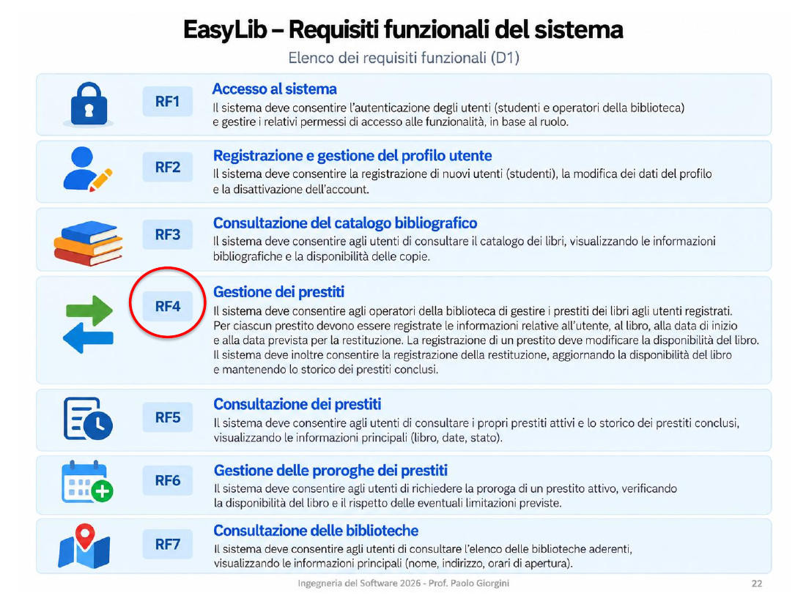
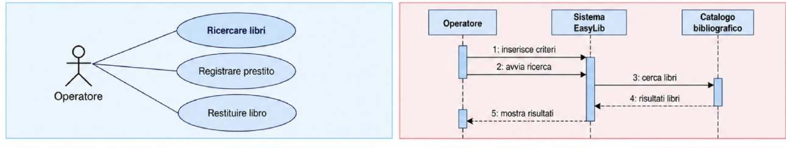
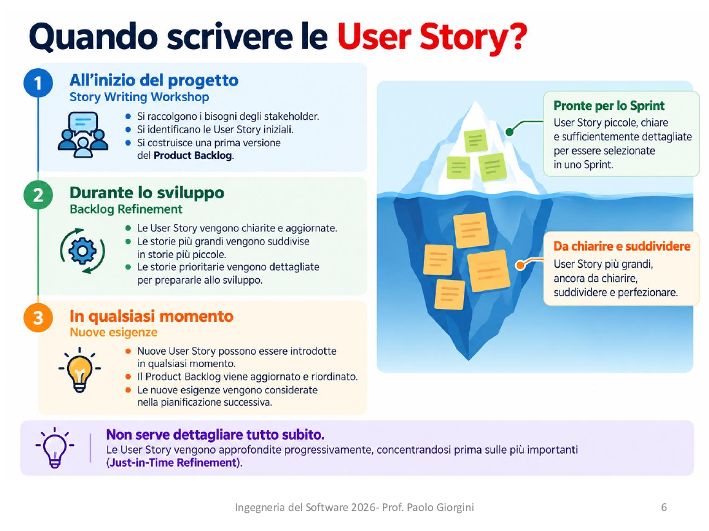
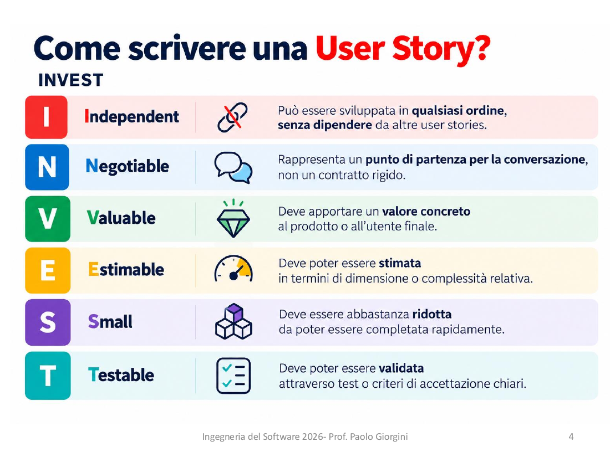
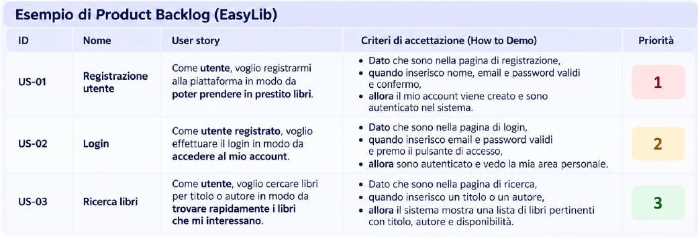
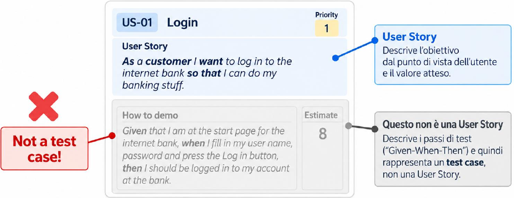
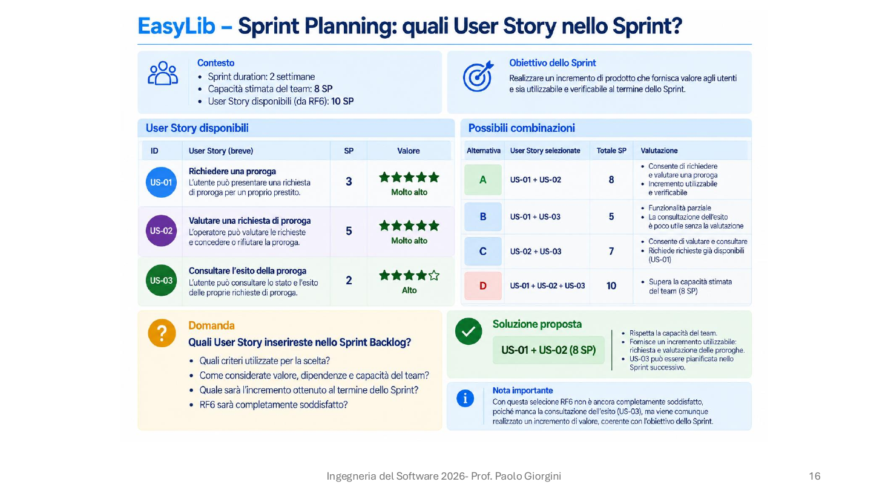
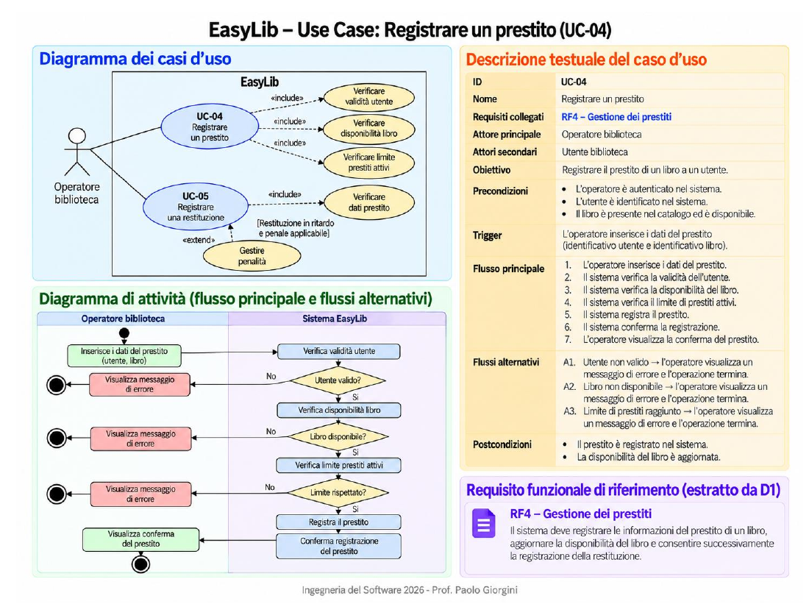

# **Dalla User Story al codice**

Da **S**pecification **D**riven **D**evelopment a AI-Native **S**oftware **D**evelopment **L**ife **C**ycle

*Software Engineering - Lab*

#### Marco Robol - marco.robol@unitn.it

---

# 🗺️ Contenuti

- **Da dove partiamo** – RF, Use Case e User Story di EasyLib (lezioni precedenti 6–8)
- **✍️ Tu scrivi** – Dalla User Story al codice (tutto a mano)
- **🤖 Tu validi** – Ciclo strutturato con OpenCode (tu validi, l'agente scrive)
- **🚀 Tu decidi** – Workshop sull'automazione con agenti

> Progetto di riferimento: **EasyLib**

---

<!-- _class: small -->

# 👀 Il percorso in un colpo d'occhio

Lo stesso ciclo, tre volte: cambia **chi scrive** e **dove vive il contesto**.

| | ✍️ Parte 1 | 🤖 Parte 2 | 🚀 Extra (Workshop) |
|---|---|---|---|
| **Ruolo** | *Tu scrivi* | *Tu validi* | *Tu decidi* |
| **Metodo** | Uno sprint: code first (US-01), TDD (US-02), review | Spec-driven con OpenCode | AI-native |
| **Chi scrive** | Il team; nel repo solo test e codice | OpenCode, in dialogo | Agenti specialistici |
| **OpenCode** | Solo genera codice, prompt unico | Produce intent, spec, plan | Orchestrazione completa |
| **Contesto** | Nel team | Nel repo | Orchestrato |
| **Gate** | Review della PR | Approvi ogni artefatto | Gate umani espliciti |

**Gate**: punto di controllo tra due passi; si prosegue solo dopo un'approvazione esplicita o un controllo superato.

---

<!-- _class: small -->

# 🧭 Da Spec-Driven ad AI-Native

| Approccio | Idea chiave | Fonte di verità | Artefatto |
|---|---|---|---|
| 🧱 **Code-first** | Si scrive il codice, poi (forse) i test | Il codice | – |
| 🔴 **TDD** | Test rosso, poi codice: *red → green → refactor* | I test | Unit test |
| 🎲 **Vibe coding** | Prompt, codice accettato senza leggerlo | La sessione | – |
| 📐 **Spec-Driven** | Specifica approvata prima; il codice ne deriva | La specifica | `spec.md`, OpenAPI |
| 🤖 **AI-Native** | Agenti scrivono spec e codice; l'umano decide ai **gate** | Spec + gate | `AGENTS.md`, `specs/` |

La specifica torna centrale con gli agenti: **non ricorda** le sessioni precedenti, il contesto deve stare nei file; **esegue** ciò che legge: una spec ambigua produce codice sbagliato, velocemente.

---

<!-- _class: small -->

# 🔄 Il ciclo

```
 0. Prima         D1: RF ──► Use Case ──► US + AC + SP ──► Product Backlog (Issue)
                  Team: accordi DoR e DoD (template di Issue e PR)
 1. Refinement    Issue ──► AC rivisti + How to Demo ──► US "pronta" (DoR)
 2. Planning      Sprint Goal ──► US selezionate (capacità) + task in ore
                  ──► Sprint Backlog (milestone)
 3. Sprint        Assegna + branch ──► Test (rossi) ──► Implementazione ──► Verifica
                  ──► Pull Request ──► Review ──► Merge (DoD)
 4. Fine sprint   Sprint Review (Demo) ──► Retrospective
```

- Ogni freccia è una **decisione** presa in un ordine preciso
- Gli **identificatori** (RFxx, UCxx, USxx, ACxx) mantengono il collegamento tra i vari passi

---

<!-- _class: section -->

# 🎲 La trappola del Vibe Coding

> *Vibe coding* (A. Karpathy, 2025): descrivi cosa vuoi a un agente, accetti il codice senza leggerlo, procedi finché funziona. Ottimo per prototipi; **non scala** quando il progetto deve durare.

---

<!-- _class: small -->

# 🎲 Vibe Coding

Su un repository di prova, **senza alcun documento**:

1. Un solo prompt a OpenCode: *"EasyLib è una piattaforma per i prestiti bibliotecari (Express, MongoDB). Implementa `GET /api/v1/books`"*;

1. L'agente produce in autonomoia:

    - `app/models/book.js` – schema Mongoose: `title`, `author`, `isbn`, `genre`, `year`, `available`
    - `app/books.js` – route che risponde con un array e campo `self`
    - `app/books.test.js` – test: 200 con array
    - registrazione della route in `index.js`

    Funziona ✅ …ma nessuno ha letto il codice, ma **nessuna traccia** del perché: nessun RF, nessuna User Story, nessun criterio.

1. Il giorno dopo: "*aggiungi la restituzione dei libri*"; OpenCode **non ricorda nulla**: la descrizione era solo nel prompt di ieri. Deve rileggere il codice per ricostruire il contesto ❌


***Usare un agente non è necessariamente vibe coding: il resto del percorso mostra come usarlo con metodo.***

---

<!-- _class: section -->

# 📚 Ripartiamo con metodo

## Dal D1 di EasyLib alla User Story

Requisiti, Use Case e User Story
(da lezioni precedenti 6, 7 e 8)

---

<!-- _class: small -->

# 📋 RF3 – Consultazione del catalogo



> Il sistema deve consentire agli utenti e agli operatori di consultare il catalogo bibliografico e individuare i libri di interesse mediante informazioni quali titolo, autore, casa editrice e ISBN.

Partiamo da qui perché **non dipende da nulla**: niente login, niente prestiti. Su un repo vuoto è il primo passo naturale.

Gli altri requisiti funzionali di EasyLib:
**RF1** Accesso al sistema · **RF2** Registrazione e profilo utente · **RF4** Gestione dei prestiti · **RF5** Consultazione dei prestiti · **RF6** Proroghe · **RF7** Consultazione delle biblioteche

<!-- _footer: 'Fonte: P. Giorgini, Ingegneria del Software 2026, lez. 6 p.5 e lez. 8 p.22' -->

---

<!-- _class: small -->

# 🎭 Dagli Use Case alle User Story



Ogni Use Case del D1 genera una o più **User Story**: da *Ricercare libri* (UC-03) nasce **US-01**, da *Registrare prestito* e *Restituire libro* (UC-04, UC-05) le US del prestito.

<!-- _footer: 'Fonte: P. Giorgini, Ingegneria del Software 2026, lez. 6 p.55' -->

---

<!-- _class: code -->

# 🌳 EasyLib: da RF a Use Case a User Story

```
EasyLib/
├── RF1-accesso-al-sistema/
│   └── US-02-login-operatore
├── RF3-consultazione-catalogo/              ← Lezione 1
│   └── UC-03-ricercare-libri/
│       └── US-01-ricerca-libri
└── RF4-gestione-prestiti/                   ← Lezione 2
    ├── UC-04-registrare-prestito/
    │   └── US-03-registrazione-prestito
    └── UC-05-registrare-restituzione/
        └── US-04-registrazione-restituzione
```

Ogni RF è un'**epic**. I legami reali sono molti-a-molti: si tengono con gli **ID**.

RF2, RF5, RF6 e RF7 restano nel D1, fuori da questo percorso. Priorità, stime e dipendenze: nel **Product Backlog**.

---

<!-- _class: section -->

# 🧰 Prima dello sprint

## Ruoli, Product Backlog, repository e accordi del team

Si fa una volta, prima del primo sprint

---

<!-- _class: small -->

# 👥 Ruoli nello sprint

| Ruolo | Chi | Cosa fa |
|---|---|---|
| **Stakeholder** (cliente) | Il docente | Possiede il **D1**; risponde alle domande che il team non sa risolvere |
| **Product Owner** | Uno studente del team, a rotazione | Ordina il backlog per valore, porta le domande aperte allo stakeholder, accetta le US in demo |
| **Scrum Master** | Uno studente del team, a rotazione | Facilita refinement, planning e retrospective; tiene d'occhio DoR e DoD |
| **Developers** | Tutto il team | Stimano, scompongono in task, scrivono test e codice, fanno review |

> Il PO **non è il cliente**: lo rappresenta nel team.

---

<!-- _class: section -->

# 📋 Product Backlog

## A cura del Product Owner

Per ora il backlog è quello del **D1** (PDF): nessuno strumento, nessun file nel repo.

---

<!-- _class: small -->

## 📋 Product Backlog 1/2

### 🗂️ Le US del D1, ordinate per valore

```markdown
| Prio | ID    | User Story                 | SP | Riferimenti | Dipende da   |
|------|-------|----------------------------|----|-------------|--------------|
| 1    | US-01 | Ricerca libri              | 3  | RF3, UC-03  | –            |
| 2    | US-02 | Login operatore            | 3  | RF1         | –            |
| 3    | US-03 | Registrazione prestito     | 5  | RF4, UC-04  | US-01, US-02 |
| 4    | US-04 | Registrazione restituzione | 3  | RF4, UC-05  | US-03        |
```

Il backlog è un **indice**: priorità **ordinata per valore** (Product Owner), stima e dipendenze. I dettagli stanno nella **scheda** di ogni US.

---

<!-- _class: code -->

## 📋 Product Backlog 2/2

### 📇 La scheda di US-01 (dal D1)

```markdown
US-01 – Ricerca libri
Come utente, voglio cercare libri per titolo o autore,
in modo da trovare rapidamente i libri che mi interessano.

Riferimenti: RF3, UC-03 · Stima: 3 SP · Dipende da: –

Criteri di accettazione
- AC-US01-01 L'utente può cercare libri per titolo.
    Dato che "I promessi sposi" è nel catalogo, quando cerco "I promessi sposi",
    allora lo vedo tra i risultati
- AC-US01-02 L'utente può cercare libri per autore.
    Dato che "Il nome della rosa" di Eco è nel catalogo, quando cerco "Eco",
    allora lo vedo tra i risultati
- AC-US01-03 Per ogni libro trovato il sistema mostra titolo, autore e disponibilità.
    Dato che "Il nome della rosa" è in prestito, quando lo trovo,
    allora vedo titolo, autore e "non disponibile"

Note: ricerca senza criteri? Casa editrice e ISBN (RF3) in scope?
```

Formato della lez. 8. Ogni AC: frase **dichiarativa** con ID + **scenario utente**, senza HTTP.

<!-- _footer: 'Formato: P. Giorgini, Ingegneria del Software 2026, lez. 8 p.26' -->

---

<!-- _class: section -->

# 🛠️ Setup del repo

## A cura del team

Nel **repo** solo codice: README e uno scheletro di partenza.

> Gate: **l'app parte su `main`** (`npm start`).

---

<!-- _class: small -->

## 🛠️ Setup del repo 1/3

### 📝 README.md

```markdown
# EasyLib

Piattaforma fullstack per la gestione dei prestiti bibliotecari universitari.
Gli utenti consultano il catalogo e i propri prestiti; gli operatori
della biblioteca registrano prestiti e restituzioni.

## Stack
- **Backend**: Node.js, Express 5, MongoDB (Mongoose), JWT
- **Frontend**: Vue 3, Vite
- **Test**: Jest, Supertest
```

Scritto **a mano**: è la prima decisione di progetto (cosa e con quale stack).

`git commit -m "docs: add README"`

---

<!-- _class: code -->

## 🛠️ Setup del repo 2/3

### 🏗️ Scheletro minimo

```
EasyLib/
├── README.md
├── .gitignore
├── .env.example        # PORT, SUPER_SECRET, DB_URL
├── package.json        # express, mongoose, dotenv · "type": "module"
└── index.js            # si connette a MongoDB, avvia Express, GET / → { status: "ok" }
```

Solo ciò che serve a **tutto il team** per partire: config comune e app che si avvia. Si fa **una volta**, su `main`, prima di aprire i branch: così nessuno modifica `package.json` e `index.js` in parallelo.
**Niente requisiti nel repo**: stanno nel D1.

---

<!-- _class: code -->

## 🛠️ Setup del repo 3/3

### 🤖 Il prompt per lo scheletro

```
Crea lo scheletro minimo di un backend Node.js per il progetto EasyLib
(gestione prestiti bibliotecari). Il repository contiene solo README.md.

Crea:
- package.json con "type": "module", script "start": "node index.js",
  dipendenze express (v5), mongoose, dotenv
- index.js che carica .env, si connette a MongoDB (DB_URL) e avvia
  Express sulla porta PORT, con GET / che risponde { status: "ok" }
- .env.example con PORT, DB_URL, SUPER_SECRET (valori di esempio)
- .gitignore con node_modules e .env

Vincoli:
- niente modelli, route o cartelle per le entità (libri, utenti, prestiti):
  nasceranno con le User Story
- niente test e test runner: arriveranno dopo
- nessuna dipendenza oltre a quelle elencate
```

1. **Leggi** il diff: i vincoli in negativo sono quelli che un agente tende a violare
2. `cp .env.example .env` · `npm install` · `npm start` → `GET /` risponde `{ "status": "ok" }` ✅ gate
3. `git commit -m "chore: minimal skeleton"`

---

<!-- _class: small -->

# 🤝 Accordi del team: DoR e DoD

Prima del primo sprint il team concorda **quando** una US può entrare nello sprint e **quando** è finita:

| | Quando si usa | Checklist per EasyLib |
|---|---|---|
| **Definition of Ready** | Refinement e Sprint Planning: entra nello sprint solo se è *ready* | INVEST · AC con ID e scenario · stima in SP · dipendenze chiuse |
| **Definition of Done** | Pull request e merge: è *done* solo se… | test verdi per ogni AC · review approvata · `oas3.yaml` aggiornato |

- La DoR protegge lo sprint da US **ambigue**
- La DoD protegge il prodotto da US **a metà**: test e documentazione sono lavoro da pianificare, non extra
- Sono accordi del **team**, non regole del docente: si rivedono nella retrospective

---

<!-- _class: section -->

# ✍️ Lezione 1: Tu scrivi

## Uno sprint, dalla User Story al codice

Inizio sprint → US-01 code first → US-02 test first, con Issue → fine sprint

---

# 🎯 Lezione 1 – Obiettivo

Simulare **un intero sprint** su EasyLib, toccando con mano ogni decisione e l'ordine in cui va presa.

- Tutti i passi sono eseguiti manualmente
- Il product backlog è mantenuto dal team stesso fuori dal repository

**OpenCode** è comunque ammesso ma **solo per supportare la scrittura del codice** con prompt diretti, non ha accesso diretto al product backlog.

---

<!-- _class: small -->

# 🗺️ Lo sprint

| Fase | Cosa si fa | Dove |
|---|---|---|
| 🏁 **Inizio sprint** | Refinement, Sprint Planning, Sprint Backlog | Team + PO, lavagna |
| 🧱 **US-01 – Code first** | Branch → codice → PR → review → merge | `feature/us-01` |
| 🔴 **US-02 – Test first, con Issue** | Issue → branch → test → codice → PR → merge | Issue, `feature/us-02` |
| 🏆 **Fine sprint** | Demo, retrospective, backlog nelle Issue | PO, team |

Ruoli, Product Backlog e repo sono già pronti (sezione precedente). Due US, due modi di lavorare: ogni US chiude il suo ciclo con **PR, review e merge**; alla fine si vede **cosa cambia**.

---

<!-- _class: section -->

# 🏁 Inizio sprint

## Cosa facciamo in questo sprint?

Refinement → Sprint Planning → Sprint Backlog

---

<!-- _header: '' -->
<!-- _paginate: false -->
<!-- _footer: 'Fonte: P. Giorgini, Ingegneria del Software 2026, lez. 8 pp.4, 6' -->




---

<!-- _class: small -->

### 🔍 Refinement della US

**Prima dello Sprint Planning** il team, con il **Product Owner**, riprende la scheda di US-01 e la rende *pronta*:

```markdown
US-01 – Ricerca libri
Come utente, voglio cercare libri per titolo o autore,
in modo da trovare rapidamente i libri che mi interessano.
```

- **Domande aperte** (dalle note della scheda): ricerca senza risultati? `promessi` trova *I promessi sposi*? Casa editrice e ISBN in scope? Il PO le porta allo **stakeholder**
- **INVEST**, una domanda per lettera:
  - **I**ndependent: dipende da altre US? → no, è la prima del backlog
  - **N**egotiable: cosa si può negoziare? → casa editrice e ISBN in una US successiva
  - **V**aluable: perché serve? → la parte *in modo da* della US
  - **E**stimable: la stima del D1 regge ancora? → 3 SP, confermati
  - **S**mall: sta in uno sprint o va scomposta?
  - **T**estable: ogni comportamento ha un criterio verificabile? → AC-US01-xx

> La US supera la **Definition of Ready** → può entrare nello Sprint Planning. Stesso lavoro per **US-02**.

---

<!-- _class: code -->

### ✅ Criteri di accettazione rivisti

Il refinement parte dagli AC del D1 e aggiunge le risposte dello stakeholder alle domande aperte:

```markdown
US-01 – Ricerca libri · Criteri di accettazione (rivisti nel refinement)

Dal D1
- AC-US01-01 L'utente può cercare libri per titolo.
- AC-US01-02 L'utente può cercare libri per autore.
- AC-US01-03 Per ogni libro trovato mostra titolo, autore e disponibilità.

Dal refinement (risposte dello stakeholder)
- AC-US01-04 Se nessun libro corrisponde, il sistema lo segnala.
    Dato il catalogo, quando cerco "zzz", allora vedo "nessun libro trovato"
- AC-US01-05 Trova anche parti del titolo, senza distinguere maiuscole.
    Dato "I promessi sposi" nel catalogo, quando cerco "PROMESSI", allora lo trovo

Fuori scope: casa editrice e ISBN (RF3) → nuova US
```

---

<!-- _class: small -->
<!-- _footer: 'Fonte: P. Giorgini, Ingegneria del Software 2026, lez. 7 p.23 e lez. 8 p.7' -->

### 📎 Gli scenari degli AC sono anche il **How to Demo** (lez. 7).





> Nella lez. 7 la ricerca libri è US-03; nel nostro backlog è **US-01**.

---

<!-- _header: '' -->
<!-- _paginate: false -->
<!-- _footer: 'Fonte: P. Giorgini, Ingegneria del Software 2026, esercizio completo p.16' -->



---

<!-- _class: small -->

### 🗓️ Sprint Planning

- **Perché?** → lo **Sprint Goal**: *catalogo consultabile e accesso degli operatori*
- **Cosa?** → le US *pronte* che stanno nella capacità del team: **US-01 + US-02** (6 SP)
- **Come?** → i Developers scompongono ogni US in **task**, in ordine di dipendenza, stimati in **ore**

### 📌 Sprint Backlog, per ora alla lavagna

```markdown
# Sprint 1
Goal: catalogo consultabile e accesso degli operatori

## US-01 Ricerca libri (3 SP)
- AC-01…03 dal D1
- AC-04 nessun risultato → lista vuota          (refinement)
- AC-05 ricerca parziale, senza maiuscole       (refinement)
- T1 modello Book e dati di prova (2h) · T2 ricerca (3h) · T3 route (1h)

## US-02 Login operatore (3 SP)
- AC-01…03 dal D1
- T0 test (2h) · T1 modello Operator (2h) · T2 login (3h) · T3 tokenChecker (2h)
```

---

<!-- _class: section -->

# 🧱 US-01 Ricerca libri

## Code first - Fa quello che serve?

Branch → task → PR → review → merge

---

<!-- _class: small -->

# 🧱 US-01-T1 – modello e dati di prova

`git switch main && git pull && git switch -c feature/us-01`, poi i task **in ordine**, un prompt ciascuno:

```
Contesto — EasyLib, Express + Mongoose (vedi package.json e index.js).

User Story US-01: come utente, voglio cercare libri per titolo o autore,
in modo da trovare rapidamente i libri che mi interessano.

Task T1 — crea app/models/book.js con lo schema Mongoose Book:
title, author, isbn (stringhe), available (booleano, default true).
Crea scripts/seed.js che inserisce alcuni libri di prova, tra cui
"I promessi sposi" (Manzoni, disponibile) e "Il nome della rosa" (Eco, in prestito).
Solo questo task: niente route, niente test, nessuna nuova dipendenza.
```

1. **Leggi** il diff: a differenza del vibe coding, il codice lo controlli tu
2. `node scripts/seed.js` → i libri sono nel database
3. `git commit -m "feat: book model"`

---

<!-- _class: code -->

# 🧱 US-01-T2 – route di ricerca

Il prompt per **T2** porta con sé US e **AC**, copiati dalla lavagna: è qui che stanno le regole della ricerca.

```
Contesto — EasyLib, Express + Mongoose. Il modello Book esiste già
(app/models/book.js: title, author, isbn, available).

User Story US-01: come utente, voglio cercare libri per titolo o autore,
in modo da trovare rapidamente i libri che mi interessano.
Criteri di accettazione:
- AC-US01-01 l'utente può cercare libri per titolo
- AC-US01-02 l'utente può cercare libri per autore
- AC-US01-03 per ogni libro trovato mostra titolo, autore e disponibilità
- AC-US01-04 se nessun libro corrisponde, restituisce una lista vuota
- AC-US01-05 trova anche parti del titolo, senza distinguere maiuscole

Task T2 — crea app/books.js con la route GET /api/v1/books?title=…&author=…
Solo questo task: non registrare la route, non scrivere test,
non aggiungere dipendenze.
```

1. **Leggi** il diff: i filtri rispettano gli AC?
2. `git commit -m "feat: search books"`

---

<!-- _class: small -->

# 🧱 US-01-T3 – registrazione e prova manuale

```
Contesto — EasyLib, Express. Esiste app/books.js con un router Express
per GET /api/v1/books.

Task T3 — registra il router di app/books.js in index.js.
Solo questo task: non modificare app/books.js, niente test.
```

1. **Leggi** il diff → `git commit -m "feat: mount books route"`
2. `npm start` e prova **a mano** con Postman (o il browser):

| Richiesta | Atteso | AC |
|---|---|---|
| `GET /api/v1/books?title=I promessi sposi` | 200, il libro, disponibile | ✅ 01, 03 |
| `GET /api/v1/books?author=Eco` | 200, *Il nome della rosa*, non disponibile | ✅ 02, 03 |

3. `git push -u origin feature/us-01`

---

<!-- _class: code -->

# 🔀 US-01 – Pull request

Su GitHub: **New pull request** da `feature/us-01` verso `main`.

```markdown
## US
US-01 – Ricerca libri   ·   (nessuna Issue)

## Cosa cambia
- Modello Book e dati di prova
- GET /api/v1/books con filtri ?title= e ?author=

## AC ↔ verifica
| AC              | Come è stato verificato              |
|-----------------|--------------------------------------|
| AC-US01-01…03   | Prova manuale con Postman            |
| AC-US01-04…05   | ?                                    |

## Definition of Done
- [ ] test verdi per ogni AC   - [ ] review approvata   - [ ] oas3.yaml aggiornato
```

Già scrivere la PR fa emergere il buco: AC-04 e AC-05 **non sono verificati**, e mancano i test.

---

<!-- _class: code -->

# 📄 La DoD come template della PR

Scritta nel repo, il team la ritrova **ogni volta** che apre una pull request:

```text
<!-- .github/pull_request_template.md -->
## US
<ID e titolo>   ·   Closes #.. (se esiste una Issue)

## Cosa cambia

## AC ↔ verifica
| AC | Come è stato verificato |

## Definition of Done
- [ ] test verdi per ogni AC
- [ ] review approvata
- [ ] oas3.yaml aggiornato
```

`git commit -m "chore: PR template"`

La DoR, per ora, è una checklist che il team ripassa a voce nel refinement.

---

<!-- _class: small -->

# 💬 US-01 – Review

Un compagno legge il diff. Prima domanda: *"dove sono scritti gli AC?"* → nella foto della lavagna. Poi il commento:

> **`app/books.js`**: la ricerca usa un confronto esatto `title === req.query.title`. **AC-US01-05** chiede di trovare anche parti del titolo senza distinguere maiuscole: `GET api/v1/books?title=promessi` deve trovare *"I promessi sposi"*. E la **DoD** chiede test verdi: non ce ne sono.

Lo sviluppatore corregge **sullo stesso branch**:

1. Installa il runner: `npm install --save-dev jest supertest` → `chore: add test runner`
2. Scrive i test per AC-US01-01…05 → 🔴 3/5 → `test: US-01 acceptance tests`
3. Corregge la ricerca → 🟢 5/5 → `fix: partial case-insensitive search`
4. `git push`: la PR si aggiorna, il revisore approva

---

<!-- _class: small -->

# ✅ US-01 – Merge

Si fa merge **solo se** la PR rispetta la **Definition of Done**:

- ✅ tutti i test verdi, ognuno legato a un AC
- ✅ review approvata da almeno un compagno
- ✅ `oas3.yaml` aggiornato con l'endpoint di ricerca

US-01 è *done*. Ma:

- il bug l'ha trovato un **compagno**, non un test; i test sono arrivati **dopo**, per correggere
- AC-04 e AC-05 vivono in una **foto della lavagna**: la PR non è collegata a nessun documento
- tra un mese, chi saprà **perché** la ricerca ignora le maiuscole?

> Su US-02 il team cambia due cose: **prima i test**, e una **Issue** che tiene insieme US, AC e PR.

---

<!-- _class: section -->

# 🔴 US-02 Login operatore

## Test first, con Issue

Issue → branch → test → codice → PR → review → merge

---

<!-- _class: code -->

# 📌 La Issue: un posto per US, AC e decisioni

Il team aggiunge un **template di Issue** con la DoR, e il PO crea la Issue di US-02 nella milestone **Sprint 1**:

```text
<!-- .github/ISSUE_TEMPLATE/user-story.md -->
# US-xx – <titolo>
Come <ruolo>, voglio <obiettivo>, in modo da <valore>.
Riferimenti: RF.., UC.. · Stima: .. SP · Dipende da: ..
## Criteri di accettazione
- [ ] AC-USxx-01 <frase>  ·  Dato … quando … allora …
## Task
- [ ] T0 …
## Definition of Ready
- [ ] INVEST   - [ ] AC con ID e scenario   - [ ] stimata   - [ ] dipendenze chiuse
```

`git commit -m "chore: issue template"`

- La **milestone** *Sprint 1* raccoglie le Issue dello sprint: è lo **Sprint Backlog**, con l'avanzamento
- Chi inizia a lavorare se la **assegna**; la PR la **chiude** con `Closes #..`

---

<!-- _class: code -->

# 🔴 Issue #2 – US-02 Login operatore

```markdown
# US-02 – Login operatore                       (Issue #2 · milestone Sprint 1)
Come operatore, voglio autenticarmi,
in modo da accedere alle funzioni di gestione.
Riferimenti: RF1, RNF1 · Stima: 3 SP · Dipende da: –

## Criteri di accettazione
- [ ] AC-US02-01 Con credenziali valide l'operatore accede.
      Dato l'operatore "mario@easylib.it", quando accede con la sua password,
      allora entra nell'area di gestione
- [ ] AC-US02-02 Con credenziali errate l'accesso è negato.
      Dato l'operatore "mario@easylib.it", quando sbaglia la password,
      allora l'accesso è negato
- [ ] AC-US02-03 Le funzioni di gestione sono accessibili solo dopo l'accesso.
      Dato un visitatore non autenticato, quando apre l'area di gestione,
      allora l'accesso è negato

## Task
- [ ] T0 test (2h)
- [ ] T1 modello (2h)
- [ ] T2 login (3h)
- [ ] T3 tokenChecker (2h)
```

È la **#2** perché GitHub numera Issue e PR insieme: la **#1** è la PR di US-01.

---

<!-- _class: small -->

# 🔴 Ciclo TDD su US-02

Ci si **assegna** la Issue #2 e si apre il branch: `git switch main && git pull && git switch -c feature/us-02`

Il runner c'è già (installato nella review di US-01). Questa volta si usa **prima** del codice, con il ciclo **red → green → refactor**:

1. 🔴 scrivi un test che **fallisce**: il comportamento non esiste ancora
2. 🟢 scrivi il codice **minimo** per farlo passare
3. ♻️ migliora il codice, con i test come rete di sicurezza

---

<!-- _class: small -->

# 🔴 Task di US-02: prima i test

| Task | Cosa | Dipende da | Commit |
|---|---|---|---|
| **T0** | Test di accettazione, uno per AC: **tutti rossi** | – | `test: US-02 acceptance tests (#2)` |
| **T1** | Modello `Operator` (email, password con hash) + operatore di prova | T0 | `feat: operator model (#2)` |
| **T2** | `POST /api/v1/authentications` → token JWT, registrata in `index.js` | T1 | `feat: login (#2)` |
| **T3** | Middleware `tokenChecker` + `GET /api/v1/operators/me` protetta, registrata | T2 | `feat: token checker (#2)` |

- **T0 viene prima di tutto**: i test definiscono quando la US è finita
- Ogni task successivo ha un obiettivo misurabile: **far diventare verdi** alcuni test
- `(#2)` nel messaggio collega ogni commit alla Issue

---

<!-- _class: small -->

### 🔴 US-02-T0 – Dal criterio al test (Given-When-Then)

**Given-When-Then** (sintassi *Gherkin*, nata con il BDD): *Given* lo stato iniziale, *When* l'azione, *Then* il risultato atteso. Gli scenari **utente** della scheda diventano **test case** a livello HTTP:

```gherkin
# Given (per tutti): operatore "mario@easylib.it" con password "secret"

# AC-US02-01
When  POST /api/v1/authentications { email: "mario@easylib.it", password: "secret" }
Then  200 con un token

# AC-US02-02
When  POST /api/v1/authentications { email: "mario@easylib.it", password: "sbagliata" }
Then  401 Unauthorized

# AC-US02-03
When  GET /api/v1/operators/me senza token
Then  401 Unauthorized
When  GET /api/v1/operators/me con il token ottenuto
Then  200 con l'email dell'operatore
```

Non serve un file a parte: gli scenari vanno nel **prompt di T0** e diventano i **test**. Nella Lezione 2 vivranno in `spec.md`.

---

<!-- _class: code -->

### 🔴 US-02-T0 – I test, prima del codice

Il prompt scrive **solo** i test, con gli scenari della slide precedente incollati dentro:

```
Scrivi test/authentications.test.js (Jest + Supertest): un test per ogni
scenario di US-02 qui sotto, con il nome che cita l'AC. Non implementare nulla.
<scenari Given-When-Then>
```

Il test generato porta con sé lo scenario:

```js
describe('US-02 Login operatore', () => {
  // Given: operatore "mario@easylib.it" con password "secret"
  beforeAll(async () => { /* crea l'operatore di prova */ });

  it('AC-US02-02 password errata → 401', async () => {
    const res = await request(app)                       // When
      .post('/api/v1/authentications')
      .send({ email: 'mario@easylib.it', password: 'sbagliata' });
    expect(res.status).toBe(401);                        // Then
  });
});
```

`npm test` → 🔴 4 rossi → `git commit -m "test: US-02 acceptance tests (#2)"`

---

<!-- _class: code -->

# 💻 US-02-T1…T3 – Dal rosso al verde

Un prompt per task, con un obiettivo **verificabile**. Dopo ogni task: `npm test`, **leggi** il diff, commit.

```
Task T1 — crea app/models/operator.js (email, password con hash bcrypt) e
scripts/seed-operators.js con l'operatore "mario@easylib.it" / "secret".
Puoi aggiungere bcrypt. Non modificare i test.
```
→ 🔴 test 0/4: il modello da solo non basta, ma serve a T2
```
Task T2 — crea app/authentications.js con POST /api/v1/authentications
(token JWT) e registrala in index.js. Puoi aggiungere jsonwebtoken.
Obiettivo: far passare AC-US02-01 e AC-US02-02. Non modificare i test.
```
→ 🟢 test 2/4

```
Task T3 — crea il middleware app/tokenChecker.js e GET /api/v1/operators/me
protetta, registrata in index.js. Obiettivo: far passare AC-US02-03.
```
→ 🟢 test 4/4

---

<!-- _class: code -->

# 🔀 US-02 – Pull request, review, merge

```markdown
## US
US-02 – Login operatore   ·   Closes #2

## Cosa cambia
- Modello Operator, POST /api/v1/authentications (JWT), tokenChecker

## AC ↔ verifica
| AC         | Test (test/authentications.test.js)          |
|------------|----------------------------------------------|
| AC-US02-01 | AC-US02-01 credenziali valide → 200 e token  |
| AC-US02-02 | AC-US02-02 password errata → 401             |
| AC-US02-03 | AC-US02-03 /operators/me senza token → 401   |

## Definition of Done
- [x] test verdi per ogni AC   - [ ] review approvata   - [x] oas3.yaml aggiornato
```

Il revisore confronta il diff con gli AC **nella Issue**, collegata dalla PR → approva → **merge**: `Closes #2` chiude la Issue e la milestone avanza.

---

<!-- _class: small -->

# ⚖️ US-01 vs US-02

| | US-01 – code first, senza Issue | US-02 – test first, con Issue |
|---|---|---|
| **AC e decisioni** | Alla lavagna, poi copiati nel prompt | Nella Issue #2, collegata a commit e PR |
| **Bug trovato** | In review, da un compagno | Dai test, prima della PR |
| **Test** | Scritti dopo, per correggere | Scritti prima, per guidare |
| **PR** | "AC-04…05: ?" | Ogni AC ha il suo test |
| **Review** | *"Dove sono scritti gli AC?"* | Diff contro la Issue |

Test e Issue vanno nella stessa direzione: rendere il lavoro **verificabile** e **tracciabile**.

---

<!-- _class: section -->

# 🏆 Fine sprint

## Come lo condivido?

Demo → retrospective

---

<!-- _class: small -->

### 🎬 Demo (Sprint Review)

Il team **mostra** le US funzionanti al PO e allo stakeholder, seguendo gli scenari **How to Demo**:

> *Dato* che sono nella pagina di ricerca, *quando* inserisco un titolo o un autore, *allora* il sistema mostra una lista di libri pertinenti con titolo, autore e disponibilità.

US-01 e US-02 sono solo backend: la demo si fa con **Swagger UI** generato da `oas3.yaml` o con **Postman**.

| | Chi | Cosa dimostra |
|---|---|---|
| **Test** | La macchina | Il codice rispetta gli AC |
| **Review** | Un compagno | Il diff è corretto e leggibile |
| **Demo** | Il Product Owner | La US porta il **valore** promesso (*in modo da…*) |

---

<!-- _class: small -->

### 🔙 Retrospective del team

| Cose fatte bene | Cose da migliorare | Miglioramenti |
|---|---|---|
| Task piccoli, un prompt e un commit ciascuno | US-01: bug trovato solo in review | **Test first** per tutte le US |
| US-02: test verdi prima della PR | AC-04/05 rimasti su una foto della lavagna | **Una Issue per ogni US**, dal template |

Il PO applica subito il secondo miglioramento: le US rimaste diventano Issue.

| Issue | User Story | Corpo (prima riga) |
|---|---|---|
| #4 | US-03 Registrazione prestito | Prio 3 · 5 SP · RF4, UC-04 · Dipende da: US-01, #2 |
| #5 | US-04 Registrazione restituzione | Prio 4 · 3 SP · RF4, UC-05 · Dipende da: #4 |

Il **Product Backlog** ora vive nelle **Issue**: scrivere `#4` nel corpo crea un link navigabile.

---

<!-- _class: small -->

# 🏆 Lezione 1 – Conclusioni

Un repository con:

- US-01 e US-02 implementate, **test verdi**, ciascuno riferito a un AC
- una **PR mergiata per US**, con almeno un commento di review
- la **Issue #2** chiusa dalla sua PR, con il link *"Issue ↔ PR"* nella cronologia
- le Issue di US-03 e US-04 aperte per lo sprint successivo, nella retrospective

# 🚧 Il limite che emerge

Il contesto è **sparso fuori dal repo**: requisiti nel **PDF del D1**, AC e decisioni nelle **Issue**, discussioni in **chat**.

- non sono versionate insieme al codice: nulla dice quale criterio ha guidato quale riga
- quando un requisito cambia a metà implementazione devi **ricordarti a mano** quali file toccare
- un agente che riparte da zero **non vede** né la chat né la Issue: deve ricostruire tutto dal codice

La Lezione 2 porta le decisioni **dentro il repo**, accanto al codice.

---

<!-- _class: section -->

# 🤖 Lezione 2

## Ciclo strutturato con OpenCode

Gli stessi passi, artefatti generati in dialogo, approvati da te


---

<!-- _class: small -->

# 🔗 Tra le due lezioni

La Lezione 1 chiude lo **sprint 1**; lo **sprint 2**, con lo stesso processo, aggiunge il prestito:

| Sprint | US | Cosa porta nel repo |
|---|---|---|
| 1 | US-01 Ricerca libri | modello `Book`, `GET /api/v1/books` |
| 1 | US-02 Login operatore | `tokenChecker` (JWT), `POST /api/v1/authentications` |
| 2 | US-03 Registrazione prestito | modello `Booklending`, `POST /api/v1/booklendings` |

La Lezione 2 parte da qui: **US-04 – Registrare una restituzione** (RF4, UC-05), che ha bisogno di un prestito e di un operatore autenticato.


---

<!-- _header: '' -->
<!-- _paginate: false -->
<!-- _footer: 'Fonte: P. Giorgini, Ingegneria del Software 2026, lez. 8 p.23' -->



---

# 🎯 Lezione 2 – Obiettivo

Ripetere i passi della Lezione 1 su **US-04 – Registrare una restituzione** (RF4, UC-05), ma con gli artefatti intermedi generati da OpenCode.

**Il tuo ruolo cambia**: non scrivi più i documenti, li **validi**.

Le decisioni che in Lezione 1 restavano nel team e nella Issue ora vivono **nel repo**, versionate accanto al codice.

```
intent.md ──gate──► spec.md ──gate──► oas3.yaml ──gate──► plan.md ──gate──► codice
 (epic)              (US)              (contratto)          (task)
```

Ogni artefatto ha un **gate**: lo approvi, lo committi, poi passi al successivo.

---

<!-- _class: small -->

# 📥 0. Portare il contesto nel repo

Un agente legge **i file del repo**, non il PDF né le Issue. Il primo passo della Lezione 2 è portare dentro ciò che in Lezione 1 stava fuori:

| Lezione 1 (fuori dal repo) | Lezione 2 (nel repo) |
|---|---|
| D1 (PDF): attori, RF, RNF, UC | `docs/requirements.md` |
| Issue e milestone: backlog, schede, AC | indice in `docs/requirements.md`; AC in `spec.md` |
| Refinement e commenti: decisioni | `specs/<epic>/intent.md` |
| Sprint Planning: task | `specs/<epic>/<us>/plan.md` |

```
Leggi il D1 (docs/D1.pdf) e le Issue aperte (gh issue list, gh issue view).
Genera docs/requirements.md con attori, RF, RNF, UC e l'indice del backlog,
citando per ogni US il numero della Issue. Non inventare requisiti.
```
→ rileggi, poi `git commit -m "docs: add requirements"`

---

<!-- _class: code -->

## 📥 0. docs/requirements.md – output

```markdown
# Requisiti — EasyLib  (estratto dal D1)

## Attori
- Utente biblioteca (studente registrato): consulta il catalogo e i propri prestiti
- Operatore biblioteca (personale): registra prestiti e restituzioni

## Requisiti funzionali
- RF1 Accesso al sistema
- RF3 Consultazione del catalogo: ricerca per titolo, autore, casa editrice, ISBN
- RF4 Gestione dei prestiti: registrazione di prestiti e restituzioni,
      aggiornando la disponibilità e mantenendo lo storico dei prestiti conclusi

## Requisiti non funzionali
- RNF1 Sicurezza: le operazioni sui prestiti richiedono un token JWT valido
       e sono riservate agli operatori; il catalogo è consultabile da tutti.

## Use Case
| ID    | Use Case                       | Attore principale    | RF  |
|-------|--------------------------------|----------------------|-----|
| UC-03 | Ricercare libri                | Utente, Operatore    | RF3 |
| UC-04 | Registrare un prestito         | Operatore biblioteca | RF4 |
| UC-05 | Registrare una restituzione    | Operatore biblioteca | RF4 |
```

Il D1 resta la fonte; `requirements.md` ne è l'estratto **per l'agente**, versionato con il codice.

---

# 🧠 Contesto persistente: AGENTS.md

Poi fagli generare `AGENTS.md` a partire da `README.md` e `docs/requirements.md` (e, se esistono, `docs/architecture.md` e `oas3.yaml`).

- È il **contesto che l'agente rilegge a ogni sessione**
- Il giorno dopo non deve ricostruire tutto dal codice
- Va **rivisto** da te prima del commit

```
git commit -m "docs: add AGENTS.md"
```

---

<!-- _class: small -->

# AGENTS.md – prompt

```
Leggi README.md e docs/requirements.md.
Genera AGENTS.md come file di contesto per le future sessioni OpenCode.
Includi: convenzioni di stack, vincoli espliciti, dove trovare
requisiti e artefatti, come citare gli identificatori (RF, UC, US, AC).
Non inventare dettagli architetturali — il codice non esiste ancora.
```

Nota l'ultima riga: il prompt **vincola** l'agente a non inventare.

---

<!-- _class: code -->

# AGENTS.md – output generato

```markdown
# EasyLib — contesto per OpenCode

## Stack
Node.js + Express 5 (backend), MongoDB + Mongoose (persistenza),
Vue 3 + Vite (frontend), Jest + Supertest (test).

## Convenzioni
- ES Modules ovunque (import/export, mai require)
- Messaggi di commit: Conventional Commits (feat/fix/docs/test/chore)
- Tracciabilità: cita sempre gli ID (RF, UC, US, AC) in spec, piani e nomi dei test

## Vincoli
- Non aggiungere dipendenze npm senza indicarlo esplicitamente
- Non risolvere silenziosamente ambiguità di dominio: segnalarle
- RF, RNF, UC e backlog sono in docs/requirements.md — non inventarne di nuovi

## Dove trovare le cose
- Requisiti, Use Case e backlog: docs/requirements.md
- Intent per epic: specs/<epic>/intent.md
- Spec e piano per User Story: specs/<epic>/<us-id>-<nome>/
- Architettura (quando disponibile): docs/architecture.md
- API reference (quando disponibile): oas3.yaml
```

---

<!-- _class: small -->

# 🔁 Ciclo per US-04 con OpenCode

| # | Artefatto | Chi lo produce | Il tuo gate | Commit |
|---|---|---|---|---|
| 0 | `requirements.md` | OpenCode, da D1 e Issue | Nessun requisito inventato | `docs: add requirements` |
| 1 | `intent.md` (epic) | OpenCode, con domande | Stato → approvato | `docs: intent …` |
| 2 | `spec.md` (US) | OpenCode, da intent e AC | Risolvi ogni **concern** | `docs: spec US-04` |
| 3 | `oas3.yaml` | OpenCode, dalla spec | Rileggi il contratto | `docs: openapi US-04` |
| 4 | `plan.md` | OpenCode, **plan mode** | Test prima, dipendenze | `docs: plan US-04` |
| 5 | Codice | OpenCode, task per task | Test + diff a ogni passo | per task |
| 6–7 | Verifica, confronto | Tu | AC ↔ scenario ↔ test | |

---

<!-- _class: small -->

# 💡 1. intent.md (just-in-time, per epic)

`specs/gestione-prestiti/intent.md` con le sezioni:

**Problema** · **Risultato atteso** · **Attori** · **Riferimenti** (RF, UC, US) · **Vincoli** · **Domande aperte**

- **Non lo compili a mano**: descrivi l'epic a OpenCode a voce
- OpenCode **legge `docs/requirements.md`** e fa domande solo su ciò che RF e UC non dicono
- Rileggilo, correggi ciò che non è vero, imposta lo stato su **approvato**

---

<!-- _class: small -->

# intent.md – prompt e dialogo

```
Voglio completare l'epic Gestione prestiti con la restituzione dei libri
(US-04). Leggi docs/requirements.md: RF4, UC-04, UC-05 e il backlog.

Aiutami a definire l'intent dell'epic. Fai le domande necessarie
per chiarire scope, vincoli e comportamento atteso, poi genera
specs/gestione-prestiti/intent.md usando il template standard.
```

OpenCode chiede:
1. Le penalità per restituzione in ritardo (UC-05 «extend» *Gestire penalità*) rientrano in US-04?
2. Gli operatori hanno già un ruolo distinto nel sistema, come chiede RNF1?

Risposta: **penalità fuori scope** (nuova US); **ruoli: non ancora** → resta domanda aperta.

---

<!-- _class: code -->

# specs/gestione-prestiti/intent.md – output

```markdown
# Intent: Gestione prestiti
Autore: studente. Stato: bozza.

## Problema
Gli operatori si autenticano (US-02) e registrano i prestiti (US-03), ma non possono registrarne
la restituzione: il libro resta non disponibile e il prestito non si chiude.

## Risultato atteso
L'operatore registra la restituzione di un prestito attivo. Il prestito risulta
concluso e resta nello storico; il libro torna disponibile per nuovi prestiti.

## Attori
Operatore biblioteca (principale), Utente biblioteca (secondario).

## Riferimenti
RF1, RF4, RNF1, UC-04, UC-05, US-02, US-03, US-04.

## Vincoli
Lo storico dei prestiti conclusi va mantenuto (RF4): nessuna eliminazione.
L'autenticazione JWT esistente deve essere usata (RNF1).
Penalità per ritardo fuori scope (UC-05 «extend»): nuova US.

## Domande aperte
- Gli operatori hanno un ruolo distinto dagli utenti nel sistema?
```

---

<!-- _class: small -->

# 📐 2. spec.md – prompt

Chiedi a OpenCode di derivare la spec della US **dall'intent approvato e dagli AC**. Gli AC della scheda sono già scenari **utente**: la spec li traduce a livello **HTTP**.

```
Leggi specs/gestione-prestiti/intent.md e la US-04 con i suoi AC.
Produci la specifica tecnica come
specs/gestione-prestiti/us-04-restituzione/spec.md.

La specifica deve includere:
- Endpoint coinvolti con metodo, path, auth richiesta, codici di risposta
- Modifiche al modello dati
- Scenari Given-When-Then, ciascuno collegato a uno o più AC-US04-xx
- Aree di concern: segnala esplicitamente qualsiasi vincolo
  in conflitto o punto ambiguo che richiede una decisione
  prima dell'implementazione.
```

---

<!-- _class: code -->

# spec.md – endpoint, modello, scenari

```markdown
# Spec: US-04 Registrare una restituzione  (RF4, UC-05, RNF1)

## Endpoint
PATCH /api/v1/booklendings/:id   body: { "status": "returned" }
- Auth: richiesta (tokenChecker middleware)
- 200 OK con il prestito aggiornato
- 404 Not Found se il prestito non esiste
- 409 Conflict se il prestito è già restituito
- 401 Unauthorized senza token

## Modifiche al modello dati
Booklending: status "active" | "returned"; nuovo campo `return_date`.
Il documento non viene eliminato (storico, RF4).

## Scenari
[AC-US04-01, 02, 03] Given un prestito attivo id=123
  When PATCH /api/v1/booklendings/123 {status: "returned"} con token valido
  Then 200, status = "returned", `return_date` valorizzata
  And il libro del prestito ha available = true
[AC-US04-04] Given un prestito inesistente → 404 Not Found
[AC-US04-04] Given un prestito già restituito → 409 Conflict
[AC-US04-05] Given una richiesta senza token → 401 Unauthorized
```

---

<!-- _class: small -->

# spec.md – ⚠ Aree di concern

```markdown
1. Autorizzazione: AC-US04-05 richiede un *operatore* autenticato, ma
   tokenChecker verifica solo l'autenticazione. Chiunque abbia un token
   valido (anche un utente biblioteca) può registrare una restituzione.
   Decisione richiesta prima dell'implementazione.
2. Penalità: UC-05 prevede «extend» Gestire penalità per restituzioni
   in ritardo. L'intent lo esclude, ma `return_date` sarà il dato di partenza.
```

- Il concern #1 **contraddice un AC e RNF1**
- Il PO lo porta allo stakeholder (il docente) **prima** di procedere
- Decisione: per ora solo autenticazione (401); il ruolo operatore diventa una nuova US su RF1 → annotato nell'intent, AC-US04-05 **verificato solo in parte**

> L'agente **segnala**, la decisione resta **umana**.

---

<!-- _class: small -->

# 📜 3. Contratto API

Se il progetto ha un `oas3.yaml`, chiedi a OpenCode di **estenderlo** con l'endpoint definito in `spec.md`.

```
git commit -m "docs: openapi US-04"
```

Il contratto viene aggiornato **prima** del codice: è parte della specifica, non documentazione a posteriori.

---

<!-- _class: small -->

# 🗺️ 4. plan.md – prompt (plan mode)

```
opencode --plan

Leggi specs/gestione-prestiti/us-04-restituzione/spec.md e produci
un piano di implementazione come
specs/gestione-prestiti/us-04-restituzione/plan.md.

Il piano deve indicare:
- Task: file da creare o modificare, in ordine
- Dipendenze tra i task
- Test da scrivere prima dell'implementazione, con l'AC che verificano
```

In **plan mode** l'agente ragiona e propone, ma **non modifica** il codice.

---

<!-- _class: code -->

# plan.md – output generato

```markdown
# Piano: US-04 Registrare una restituzione

## Task
1. app/models/booklending.js: status "active" | "returned", campo `return_date`
   Dipende da: —

2. app/booklendings.js: handler PATCH /api/v1/booklendings/:id
   - applicare tokenChecker alla route
   - 404 se il prestito non esiste, 409 se già restituito
   - impostare status e `return_date`, rendere disponibile il libro
   - 200 con il prestito aggiornato
   Dipende da: (1)

3. app/booklendings.test.js: test di accettazione
   - AC-US04-01/02/03: prestito attivo → 200, returned, libro disponibile
   - AC-US04-04: inesistente → 404; già restituito → 409
   - AC-US04-05: senza token → 401
   Dipende da: (2)

## Nota
Il controllo del ruolo operatore è fuori scope: vedi spec.md, concern #1.
```

---

<!-- _class: small -->

# ✋ plan.md – la correzione umana

Il piano generato mette i **test dopo** il codice. ❌

Lo studente corregge:
- i test vengono **per primi** (TDD), subito dopo il modello
- l'ordine deve rispettare le dipendenze reali

```
git commit -m "docs: plan US-04"
```

> L'errore è stato intercettato **nel piano**, non nel codice.

---

<!-- _class: small -->

# ✅ 5–6. Implementazione a passi e verifica

**Implementazione**: esegui il piano **un task alla volta**. Dopo ogni task:

1. esegui i test
2. leggi il diff
3. commit

Se un task non torna, **correggi `plan.md`** prima di continuare – non il codice in silenzio.

**Verifica contro la spec**: per ogni AC-US04-xx, segui la catena **AC → scenario in `spec.md` → test verde**.

> Un criterio senza test è un criterio **non verificato**.

---

<!-- _class: small -->

# ⚖️ 7. Confronto con processo manuale della lezione precedente

Riprendi la retrospective della Lezione 1:

- Quali passi hai **delegato**?
- Quali errori hai intercettato in **`spec.md`** o **`plan.md`** invece che nel codice?
- Il giorno dopo, quanto contesto hai dovuto **ricostruire**?

---

<!-- _class: small -->

# 🏆 Lezione 2 – Conclusioni

- `intent.md`, `spec.md`, `plan.md` committati **prima** dell'implementazione
- almeno **una correzione manuale** documentata nei commit
- test verdi, ogni AC-US04-xx collegato a uno scenario e a un test

```
EasyLib/
├── AGENTS.md
├── README.md
├── docs/
│   └── requirements.md
├── specs/
│   └── gestione-prestiti/
│       ├── intent.md
│       └── us-04-restituzione/
│           ├── spec.md
│           └── plan.md
├── oas3.yaml
├── app/
└── .github/
```

---

<!-- _class: section -->

# 🚀 Prossimi passi: AI-native SDLC

Il flusso viene orchestrato, i gate umani restano dove servono

---

# 🏭 Da *AI-supported* a *AI-native*

Fino ad ora il lavoro **passa sempre da te**: scrivi o approvi ogni artefatto, lanci ogni comando, leggi ogni diff.

Con AI-native:

- **Agenti specialistici** con responsabilità separate (requisiti, design, sviluppo) e un **coordinatore** che mantiene la tracciabilità
- **Catene di dipendenza**: quando un RF cambia, quali UC, US, spec, piani e test vanno rivisti
- **Git worktree**: più User Story dello sprint in parallelo, ciascuna nel proprio worktree
- **Pipeline CI**: test e analisi statica su ogni PR
- **Sviluppo autonomo**: l'agente esegue i task, fa i commit e apre la pull request
- **Gate umani**: nessuna approvazione, baseline o merge senza un comando esplicito

---

<!-- _class: small -->

# 🤖 OpenCode lungo tutto il ciclo

Gli stessi passi delle Lezioni 1 e 2, ma eseguiti dall'agente. Tu intervieni ai **gate**:

| Fase | Cosa fa l'agente | Gate umano |
|---|---|---|
| **Analisi** | Legge il materiale degli stakeholder, propone RF, UC, US e AC; segnala **GAP** (informazioni mancanti) e **CLAR** (punti da chiarire) | Lo stakeholder risponde; il PO approva la baseline |
| **Backlog** | Crea le Issue dal template, con AC e scenari; propone priorità e stime | Il PO ordina e conferma |
| **Spec e piano** | Genera `intent.md`, `spec.md`, `oas3.yaml`, `plan.md`; segnala i concern | Il team approva ogni artefatto |
| **Sviluppo** | Apre il branch, esegue i task in TDD, **fa i commit** da solo (`(#n)` nel messaggio) | Il team legge i diff |
| **Pull request** | **Apre la PR** (`gh pr create`) con `Closes #n`, AC ↔ test, checklist DoD | Un umano fa review e **merge** |

> L'agente può fare quasi tutto. Restano **umani**: le risposte ai GAP/CLAR, l'approvazione degli artefatti e il **merge**.

---

<!-- _class: small -->

# 🏛️ Caso reale: D1 IS 2026

Sistema multi-agente che produce e mantiene il **D1** (Requirements Engineering).

**Agenti specialistici**: `requirements-engineer`, `use-case-designer`, `user-story-developer`, `frontend-designer`
**Coordinatore**: `d1-coordinator`

```
Requirements ──► Use Cases ──► User Stories ──► Acceptance Criteria ──► Mockup
```

- Gli agenti **non inventano** requisiti né risolvono ambiguità: segnalano **GAP** e **CLAR**
- Flusso: `input/project-material/` → `/d1-requirements` → `/d1-generate` → review iterativa → PDF
- Gate umano esplicito: `/d1-baseline "approve v1.0"`
- Ogni modifica dopo la baseline diventa un **`CH-*`** nel change log

---

<!-- _class: code -->

# 🗂️ Struttura di riferimento completa

```
.
├── AGENTS.md                          # entry point per OpenCode
├── docs/
│   ├── requirements.md                # RF, RNF, UC, backlog per epic
│   ├── architecture.md
│   └── data-model.md
├── specs/
│   ├── catalogo/                      # epic (RF3)
│   │   ├── intent.md                  # intent dell'epic
│   │   └── us-01-ricerca/ ...
│   ├── accesso/                       # epic (RF1)
│   │   ├── intent.md
│   │   ├── us-02-login/ ...
│   │   └── us-xx-ruolo-operatore/ ... # nata dal concern di US-04
│   └── gestione-prestiti/             # epic (RF4)
│       ├── intent.md
│       ├── us-03-prestito/ ...
│       └── us-04-restituzione/
│           ├── spec.md
│           └── plan.md
├── src/
└── .github/workflows/ci.yml
```

Ogni lezione aggiunge uno strato.

---

<!-- _class: small -->

# 🏁 Riepilogo

| | ✍️ Lezione 1 | 🤖 Lezione 2 | 🚀 Prossimi passi |
|---|---|---|---|
| **Punto di partenza** | RF, UC, US dal D1 | RF, UC, US dal D1 | RF, UC, US dal D1 |
| **Artefatti** | Decisi nel team, poi nella Issue | Generati, validati da te | Generati da agenti specialistici |
| **Contesto** | Fuori dal repo (team, Issue) | `AGENTS.md` + `specs/` | Catene di dipendenza esplicite |
| **Errori intercettati** | Nel codice, in review | Nella spec e nel piano | In CI, prima del merge |
| **Il tuo ruolo** | Autore | Validatore | Responsabile dei gate |

> L'automazione cresce, **la responsabilità delle decisioni resta umana**.
